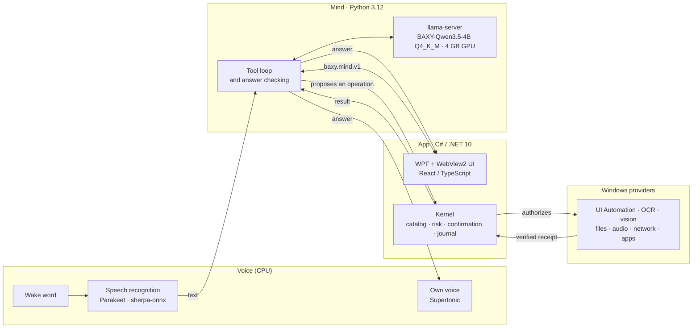

<h1 align="center">BAXY</h1>

<p align="center">
  <b>Your own Jarvis for Windows: it lives on your PC, speaks with its own voice, and never says "done" until it has checked.</b>
</p>

<p align="center">
  <a href="LICENSE"></a>
  
  
  
  <a href="https://huggingface.co/REDSOULTM/BAXY-Qwen3.5-4B-GGUF"></a>
</p>

<p align="center">
  <a href="README.md">Español</a> ·
  <a href="docs/instalacion.md">Installation</a> ·
  <a href="docs/arquitectura.md">Architecture</a> ·
  <a href="docs/evaluacion.md">Results</a> ·
  <a href="docs/construccion/README.md">How it was built</a>
</p>

BAXY is a voice assistant that lives on your Windows PC and operates it for you: it opens programs and files, works
through the windows of any application, searches the web, plays music and video, and changes system settings. It
understands **Spanish and English** (and a mix of both), and it thinks with **its own 4-billion-parameter model**,
fine-tuned for this job, which fits on a 4 GB GPU. Nothing you say leaves your machine.

What makes it different:

- **Local and private.** The model, the speech recognizer and the voice all run on your PC. BAXY may look things up
  on the web, but it never sends your data to any service.
- **Its own model.** [BAXY-Qwen3.5-4B](https://huggingface.co/REDSOULTM/BAXY-Qwen3.5-4B-GGUF) is Qwen3.5-4B with a
  LoRA fine-tune for choosing and chaining BAXY's tools. It runs on `llama.cpp`, quantized to Q4_K_M (2.7 GB).
- **Its own voice.** Wake word, local transcription with Parakeet, and a custom synthetic voice built on Supertonic.
- **Checks what it does.** Every action returns a receipt verified by the system; BAXY only says what the receipt
  confirms. When it could not check, it says so.
- **Asks before anything irreversible.** Deleting, sending, or closing something with unsaved work requires your
  confirmation, bound to that exact action.

> **Status:** under active development and used daily on its author's PC. It still fails on part of the long,
> multi-step tasks (see [results](#measured-results)). Installation is from source.

The documentation under `docs/` is written in Spanish; this page summarizes it in English.

## What it can do

More than 180 typed tools, grouped by area:

| Area | Examples |
|---|---|
| Apps and windows | Open, close, focus, minimize and arrange windows; launch Steam or Epic games |
| Any program's interface | Read visible controls (UI Automation), click, type, use shortcuts; OCR and vision when there is no accessibility tree |
| Files and folders | Search, create, move, copy, rename, compress, send to the recycle bin, read documents and PDFs |
| Web | Search, read pages, open links and tabs in your browser |
| Media | Play on Spotify and YouTube, control volume and the audio device |
| System | Brightness, Wi-Fi, Bluetooth, network, battery, storage, screenshots, clipboard |
| Organization | Notes, tasks, reminders, Outlook calendar and mail, a memory of what you ask it to remember |
| Conversation | Answer questions, compute (real arithmetic, not recall) and check the weather |

## Architecture



- **The mind proposes, the kernel authorizes, the provider executes.** The model never touches the system directly:
  it can only request operations from the typed catalog, and the kernel decides whether they need confirmation.
- **Verified receipts.** Each provider checks the effect (the window exists, the file changed, the volume is the one
  asked for) and returns a receipt. Before speaking, the mind checks the model's answer against those receipts.
- **An invocation journal** with HMAC integrity prevents repeating an action that already happened after a restart.

## Principles

1. **Say only what was verified.** "The command was sent" is not "it was done". An ambiguous result is reported as
   ambiguous.
2. **Confirm what is destructive**, bound to the exact invocation.
3. **Private by design.** The line is about direction, not connection: BAXY reads the web but never sends your
   content out. What it remembers about you can be viewed, corrected and deleted.
4. **No canned sentences.** Everything BAXY says is written by the model from what actually happened.
5. **The lightest thing that works.** 4 GB of VRAM is the ceiling, not the goal.

## Measured results

BAXY is measured with **blind benchmarks**: real missions on a Windows desktop, with an oracle that checks the final
state and a judge that reads each conversation without knowing which model produced it.

**Blind benchmark, 160 missions × 3 seeds** (current model vs. the previous one, same App):

| Metric | Previous model | Current BAXY-Qwen3.5-4B |
|---|---|---|
| Missions achieved (majority of 3) | 36 / 160 | **44 / 160** |
| Achieved in all 3 runs (pass^3) | 24 | **38** |
| False successes (claimed it, didn't) | 11 | 11 |
| Honest limits (said it could not) | 51 | 51 |
| McNemar, paired achievements | — | 9 for, 1 against, p = 0.02 |

**Time to first sound** after a fix to the spoken progress notice (3 live missions, same model): median from
**31.8 s to 4.4 s**; the first full answer is still around 50 s on those long UI missions.

Honest reading: about one in four hard missions succeeds, and in another third BAXY admits it cannot do it. False
successes are the most important open problem.

## Requirements

| | Minimum |
|---|---|
| OS | Windows 10 (2004) or Windows 11, x64 |
| GPU | NVIDIA with 4 GB of VRAM and a CUDA 12.4 capable driver (551.61 or later). It also runs on CPU, much slower |
| RAM and disk | 16 GB of RAM and about 10 GB free recommended |
| Software | .NET SDK 10.0.100, Python 3.12 x64, Visual Studio Build Tools 2022 (C++), WebView2 Runtime |
| Optional | Microphone and speakers to talk to it |

## Installation

The full guide, with every download and its SHA-256 check, is in [docs/instalacion.md](docs/instalacion.md)
(Spanish). In short:

```powershell
# 1. Clone into a folder NOT named exactly "BAXY" (see the guide)
git clone https://github.com/REDSOULTM/BAXY.git BAXY-src
cd BAXY-src

# 2. Download the model and llama.cpp b11609 (CUDA 12.4); verify their SHA-256
#    https://huggingface.co/REDSOULTM/BAXY-Qwen3.5-4B-GGUF  ->  BAXY-Qwen3.5-4B-c3-Q4_K_M.gguf

# 3. Set up BAXY's Python and register the model
$env:BAXY_MIND_LLM_GGUF     = "<path>\BAXY-Qwen3.5-4B-c3-Q4_K_M.gguf"
$env:BAXY_MIND_LLAMA_SERVER = "<path>\llama-b11609\llama-server.exe"
$env:BAXY_MIND_STT_DIR      = "<path>\sherpa-onnx-nemo-parakeet-tdt-0.6b-v3-int8"
powershell -NoProfile -ExecutionPolicy Bypass -File .\scripts\bootstrap.ps1

# 4. Start
py -3.12 main.py
```

## Development

```powershell
dotnet build Baxy.slnx -c Release -warnaserror      # App, Core, Kernel, providers and installer
dotnet test tests\Baxy.Kernel.Tests -c Release      # one .NET suite
py -3.12 -m pytest -q tests                          # mind tests (Python)
py -3.12 main.py                                     # builds what changed and launches BAXY
```

See the repository layout in the [Spanish README](README.md#desarrollo) and how to contribute in
[CONTRIBUTING.md](CONTRIBUTING.md).

## Roadmap

- Fewer false successes: the next fine-tune uses the failures measured in the blind benchmark as data.
- Faster give-up on a label that is not on screen (it takes 17 to 41 s today).
- A complete installer that includes the mind, the model and the voice.
- Publish the wake word and the speech recognizer the product uses.

## How it was built

BAXY went through three stages: a first prototype (May–June 2026), a product with a typed catalog and a kernel
that verifies every effect (August–October), and the current version, where its own fine-tuned model decides with
that catalog's tools. Decisions, measurements, fine-tuning recipes and technical reports for each stage are in
[docs/construccion/](docs/construccion/README.md) (Spanish).

## License

BAXY's own code and documentation are under the [MIT license](LICENSE). Third-party components keep their own
licenses; the full inventory, including what carries obligations, is in [THIRD_PARTY_NOTICES.md](THIRD_PARTY_NOTICES.md).
In particular:

- The **voice** is based on Supertonic 3, under **OpenRAIL-M**: it has use restrictions and requires disclosing that
  the voice is synthetic.
- The **model** derives from Qwen3.5-4B (**Apache-2.0**); the Parakeet recognizer is **CC-BY-4.0** (attribution).
- The avatar clips, backgrounds and icon are not under MIT: they were generated with Higgsfield and follow its terms.

## Author

BAXY is a project by [REDSOULTM](https://github.com/REDSOULTM).
