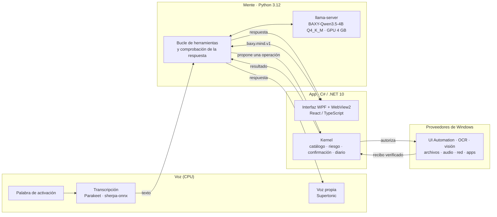

<h1 align="center">BAXY</h1>

<p align="center">
  <b>Un compañero para Windows: vive en tu PC, habla con voz propia y maneja tu escritorio por voz o por texto.</b>
</p>

<p align="center">
  <a href="LICENSE"></a>
  
  
  
  <a href="https://huggingface.co/REDSOULTM/BAXY-Qwen3.5-4B-GGUF"></a>
</p>

<p align="center">
  <a href="README.en.md">English</a> ·
  <a href="docs/instalacion.md">Instalación</a> ·
  <a href="docs/arquitectura.md">Arquitectura</a> ·
  <a href="docs/evaluacion.md">Resultados</a> ·
  <a href="docs/construccion/README.md">Cómo se construyó</a>
</p>

BAXY vive en tu PC con Windows y lo maneja por ti, por voz o por texto: abre programas y archivos, recorre las
ventanas de cualquier aplicación, busca en la web, pone música y vídeos y cambia los ajustes del sistema. Entiende
**español e inglés** (y la mezcla de los dos), y piensa con un **modelo propio de 4.000 millones de parámetros**
ajustado para esta tarea, que cabe en una GPU de 4 GB. Nada de lo que dices sale de tu máquina.

Lo que lo distingue:

- **Local y privado.** El modelo, la transcripción y la voz corren en tu PC. BAXY puede consultar la web cuando no
  sabe algo, pero nunca envía tus datos a ningún servicio.
- **Modelo propio.** [BAXY-Qwen3.5-4B](https://huggingface.co/REDSOULTM/BAXY-Qwen3.5-4B-GGUF) es Qwen3.5-4B con un
  ajuste fino LoRA hecho para elegir y encadenar las herramientas de BAXY. Corre en `llama.cpp`, cuantizado a
  Q4_K_M (2,7 GB).
- **Voz propia.** Palabra de activación, transcripción local con Parakeet y una voz sintética propia hecha con
  Supertonic.
- **Revisa lo que hace.** Cada acción devuelve un recibo del sistema y BAXY responde a partir de él. Aun así, puede
  equivocarse (ver [resultados](#resultados-medidos)).
- **Pregunta antes de hacer algo irreversible.** Borrar, enviar o cerrar algo con trabajo sin guardar pide tu confirmación,
  ligada a esa acción exacta.

> **Estado:** proyecto en desarrollo activo, usable a diario en el PC de su autor. Todavía falla en una parte de las
> tareas largas de varios pasos (ver [resultados](#resultados-medidos)). La instalación es desde el código fuente.

## Qué puede hacer

Más de 180 herramientas tipadas, agrupadas por área:

| Área | Ejemplos |
|---|---|
| Aplicaciones y ventanas | Abrir, cerrar, enfocar, minimizar y ordenar ventanas; abrir juegos de Steam o Epic |
| Interfaces de cualquier programa | Leer los controles visibles (UI Automation), pulsar, escribir, usar atajos; OCR y visión cuando no hay árbol de accesibilidad |
| Archivos y carpetas | Buscar, crear, mover, copiar, renombrar, comprimir, enviar a la papelera, leer documentos y PDF |
| Web | Buscar, leer páginas, abrir enlaces y pestañas en tu navegador |
| Multimedia | Reproducir en Spotify y YouTube, controlar el volumen y el dispositivo de audio |
| Sistema | Brillo, Wi-Fi, Bluetooth, red, batería, almacenamiento, capturas de pantalla, portapapeles |
| Organización | Notas, tareas, recordatorios, calendario y correo de Outlook, memoria de lo que le pides recordar |
| Conversación | Responder preguntas, calcular (con aritmética real, no de memoria) y consultar el tiempo |

Un turno típico: dices «BAXY, abre la calculadora y calcula 12 por 37». BAXY decide las llamadas, el sistema las
ejecuta y verifica, y BAXY contesta con su voz en una frase a partir del recibo.

## Arquitectura



- **La mente propone, el kernel autoriza, el proveedor ejecuta.** El modelo nunca toca el sistema directamente: sólo
  puede pedir operaciones del catálogo tipado, y el kernel decide si necesita confirmación.
- **Recibos verificados.** Cada proveedor comprueba el efecto (la ventana existe, el archivo cambió, el volumen es
  el pedido) y devuelve un recibo. Antes de hablar, la mente contrasta la respuesta del modelo con esos recibos.
- **Un diario de invocaciones** con integridad HMAC evita repetir una acción ya hecha si algo se reinicia.

Detalle de cada pieza en [docs/arquitectura.md](docs/arquitectura.md).

## Principios

1. **No dar por hecho lo que no se vio.** «Se envió el comando» no es «se hizo». Un resultado ambiguo se dice como tal.
2. **Confirmar lo destructivo.** La confirmación se liga a la invocación exacta, no a una intención parecida.
3. **Privado por diseño.** La línea es de dirección, no de conexión: BAXY lee la web, pero no envía contenido tuyo.
   Lo que recuerda de ti se puede ver, corregir y borrar.
4. **Sin frases fijas.** Todo lo que BAXY dice lo formula el modelo a partir de lo que pasó.
5. **Lo más ligero que cumpla.** 4 GB de VRAM son el techo, no el objetivo.

Más en [docs/identidad.md](docs/identidad.md) y [docs/privacidad-y-seguridad.md](docs/privacidad-y-seguridad.md).

## Resultados medidos

BAXY se mide con **bancos ciegos**: misiones reales sobre un escritorio de Windows, con un oráculo que comprueba el
estado final y un juez que lee cada conversación sin saber qué modelo la produjo. Cómo se mide, en
[docs/evaluacion.md](docs/evaluacion.md).

**Banco ciego de 160 misiones × 3 semillas** (modelo actual frente al anterior, misma App):

| Métrica | Modelo anterior | BAXY-Qwen3.5-4B actual |
|---|---|---|
| Misiones logradas (mayoría de 3) | 36 / 160 | **44 / 160** |
| Logradas en las 3 corridas (pass^3) | 24 | **38** |
| Éxitos falsos (dijo que lo hizo y no) | 11 | 11 |
| Límites honestos (dijo que no podía) | 51 | 51 |
| McNemar, logradas pareadas | — | 9 a favor, 1 en contra, p = 0,02 |

**Latencia hasta el primer sonido** tras un arreglo del aviso hablado (3 misiones en vivo, mismo modelo): mediana
de **31,8 s a 4,4 s**; la primera respuesta completa sigue en torno a 50 s en esas misiones largas de interfaz.

Lectura honesta: una de cada cuatro misiones difíciles sale bien; en otra tercera parte BAXY reconoce que no puede.
Los éxitos falsos son el problema abierto más importante. Los límites conocidos están en
[docs/evaluacion.md](docs/evaluacion.md#límites-conocidos).

## Requisitos

| | Mínimo |
|---|---|
| Sistema | Windows 10 (2004) o Windows 11, x64 |
| GPU | NVIDIA de 4 GB de VRAM, con driver compatible con CUDA 12.4 (551.61 o posterior). Sin GPU funciona en CPU, mucho más lento |
| RAM y disco | 16 GB de RAM y unos 10 GB libres recomendados |
| Software | .NET SDK 10.0.100, Python 3.12 x64, Visual Studio Build Tools 2022 (C++), WebView2 Runtime |
| Opcional | Micrófono y altavoces para hablarle |

## Instalación

La guía completa, con cada descarga y su comprobación SHA-256, está en [docs/instalacion.md](docs/instalacion.md).
En resumen:

```powershell
# 1. Clona en una carpeta que NO se llame exactamente "BAXY" (ver la guía)
git clone https://github.com/REDSOULTM/BAXY.git BAXY-src
cd BAXY-src

# 2. Descarga el modelo y llama.cpp b11609 (CUDA 12.4); comprueba sus SHA-256
#    https://huggingface.co/REDSOULTM/BAXY-Qwen3.5-4B-GGUF  ->  BAXY-Qwen3.5-4B-c3-Q4_K_M.gguf

# 3. Prepara el Python de BAXY y registra el modelo
$env:BAXY_MIND_LLM_GGUF     = "<ruta>\BAXY-Qwen3.5-4B-c3-Q4_K_M.gguf"
$env:BAXY_MIND_LLAMA_SERVER = "<ruta>\llama-b11609\llama-server.exe"
$env:BAXY_MIND_STT_DIR      = "<ruta>\sherpa-onnx-nemo-parakeet-tdt-0.6b-v3-int8"
powershell -NoProfile -ExecutionPolicy Bypass -File .\scripts\bootstrap.ps1

# 4. Arranca
py -3.12 main.py
```

## Desarrollo

```powershell
dotnet build Baxy.slnx -c Release -warnaserror      # App, Core, Kernel, proveedores e instalador
dotnet test tests\Baxy.Kernel.Tests -c Release      # una suite .NET
py -3.12 -m pytest -q tests                          # pruebas de la mente (Python)
py -3.12 main.py                                     # compila lo que cambió y lanza BAXY
```

Estructura del repositorio:

| Ruta | Contenido |
|---|---|
| `src/Baxy.App` | La aplicación de escritorio (WPF + WebView2), el canal con la mente y la voz |
| `src/Baxy.FieldUi` | La interfaz (React + TypeScript); `dist/` va compilado en el repositorio |
| `src/Baxy.Core` | `baxy-core.exe` (NativeAOT): ejecuta las operaciones autorizadas |
| `src/Baxy.Kernel` | Catálogo de operaciones, política de riesgo, confirmación y diario |
| `src/Baxy.Contracts` | Tipos del protocolo entre la App, el Core y la mente |
| `src/Baxy.Providers.Windows` | Efectos y lecturas reales sobre Windows |
| `src/Baxy.Security.Windows` | Protección de datos locales |
| `src/Baxy.Setup` | Instalador transaccional por usuario |
| `src/baxy_mind` | La mente: bucle de herramientas, servidor del modelo, voz |
| `tests/` | Suites .NET (NUnit) y pruebas de la mente (pytest) |
| `scripts/` | Arranque, compilación, empaquetado, voz y bancos de evaluación |
| `runtime_wheels/` | Ruedas nativas parcheadas de sherpa-onnx y WebRTC, con sus licencias |
| `docs/` | Documentación; la historia del proyecto está en `docs/construccion/` |

Cómo contribuir: [CONTRIBUTING.md](CONTRIBUTING.md).

## Hoja de ruta

- Bajar los éxitos falsos: el siguiente ajuste fino usa como datos los fallos medidos en el banco ciego.
- Pulsar más rápido un rótulo que no está en pantalla (hoy tarda de 17 a 41 s en rendirse).
- Instalador completo que incluya la mente, el modelo y la voz.
- Publicar la palabra de activación y el reconocedor que usa el producto.

## Cómo se construyó

BAXY pasó por tres etapas: un primer prototipo (mayo–junio de 2026), un producto con catálogo tipado y kernel que
verifica cada efecto (agosto–octubre) y la versión actual, donde un modelo propio ajustado decide con las
herramientas de ese catálogo. Las decisiones, mediciones, recetas de ajuste fino e informes técnicos de cada etapa
están en [docs/construccion/](docs/construccion/README.md), para quien quiera entenderlo o replicarlo.

## Licencia

El código y la documentación propios de BAXY están bajo la [licencia MIT](LICENSE). Las piezas de terceros conservan
su licencia; el inventario completo, con lo que obliga a algo, está en
[THIRD_PARTY_NOTICES.md](THIRD_PARTY_NOTICES.md). En particular:

- La **voz** se basa en Supertonic 3, bajo **OpenRAIL-M**: tiene restricciones de uso y obliga a avisar de que la voz
  es sintética.
- El **modelo** deriva de Qwen3.5-4B (**Apache-2.0**); el reconocedor Parakeet es **CC-BY-4.0** (atribución).
- Los clips, fondos e icono del avatar no están bajo MIT: se generaron con Higgsfield y se rigen por sus términos.

## Autor

BAXY es un proyecto de [REDSOULTM](https://github.com/REDSOULTM).
