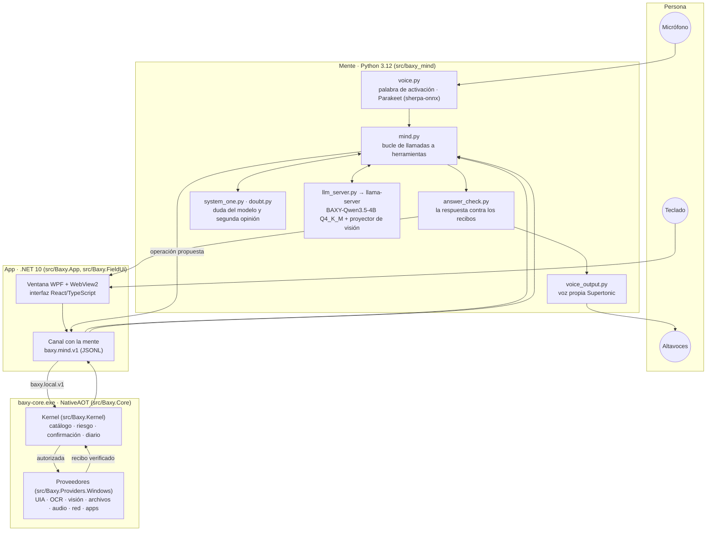

# Arquitectura

BAXY tiene tres procesos que hablan por protocolos tipados y una regla que no se negocia: **la mente propone, el
kernel autoriza, el proveedor ejecuta**. El modelo de lenguaje nunca toca Windows directamente.

## Un turno, paso a paso

1. **Entrada.** La persona escribe en la interfaz, o dice «BAXY» y su petición. La palabra de activación y el
   reconocedor Parakeet corren en la CPU; el texto llega a la mente igual que si se hubiera escrito.
2. **Decisión.** La mente envía la conversación al modelo local por `llama-server` con todas las herramientas del
   catálogo (más de 180, unos 44.000 tokens de prefijo que se guardan en caché en disco y se reutilizan). El modelo
   responde con una llamada nativa a herramienta y sus argumentos, o con texto.
3. **Autorización.** La App pasa la operación al Core. El kernel la busca en el catálogo tipado, valida los
   argumentos contra su esquema y aplica la política de riesgo: lo que destruye datos, envía algo o cierra trabajo
   sin guardar necesita confirmación, y esa confirmación queda ligada a la huella exacta de la invocación.
4. **Ejecución y verificación.** El proveedor de Windows hace el efecto y lo comprueba de forma independiente (la
   ventana existe y está al frente, el archivo tiene el contenido, el volumen quedó donde se pidió). Devuelve un
   **recibo** con lo observado; un efecto que no se pudo comprobar se marca como tal.
5. **Bucle.** La mente añade el recibo a la conversación y el modelo elige entre llamar otra herramienta o responder.
6. **Respuesta.** Antes de hablar, `answer_check.py` contrasta lo que el modelo afirma con los recibos del turno.
   Si contradice un recibo, el modelo reescribe. La respuesta se muestra y se dice con la voz propia.

Mientras tanto, si un turno va a tardar, BAXY dice un aviso corto que no afirma ningún resultado («Abro la
configuración y lo busco»), para que nunca haya silencio largo.

## Las piezas

| Pieza | Dónde | Qué hace |
|---|---|---|
| App | `src/Baxy.App` | Ventana de escritorio WPF con WebView2, bandeja, ajustes, lanza y supervisa la mente y el Core |
| Interfaz | `src/Baxy.FieldUi` | React + TypeScript (Vite). `dist/` se versiona: no hace falta Node para usar BAXY |
| Core | `src/Baxy.Core` | `baxy-core.exe`, publicado con NativeAOT. Ejecuta los manejadores de operaciones |
| Kernel | `src/Baxy.Kernel` | `Operations/ProductCatalog.cs` (el universo cerrado de operaciones), `Policy/` (riesgo y modos de confirmación), `Mission/` (autoridad de confirmación, huellas), `Journal/` (diario con HMAC y rotación) |
| Contratos | `src/Baxy.Contracts` | Tipos del protocolo `baxy.local.v1` entre la App y el Core |
| Proveedores | `src/Baxy.Providers.Windows` | Aplicaciones, ventanas, UI Automation, OCR de Windows, capturas, archivos, audio, red, Bluetooth, notas, tareas, memoria |
| Seguridad | `src/Baxy.Security.Windows` | Datos locales cifrados con DPAPI del usuario y la clave del diario |
| Instalador | `src/Baxy.Setup` | Instalación transaccional por usuario, con vuelta atrás y desinstalación |
| Mente | `src/baxy_mind` | `mind.py` (el turno), `llm_server.py` (el servidor del modelo), `wire.py` (nombres de herramientas), `answer_check.py`, `doubt.py` y `system_one.py` (calidad de la decisión), `early.py` (anticipación y latencia), `voice*.py` y `speech_text.py` (voz) |

## Manejar cualquier programa

Para las aplicaciones que no tienen una operación propia, BAXY usa una cascada de percepción:

1. **UI Automation**: lee el árbol de accesibilidad de la ventana (`input.visible.controls`) y pulsa o escribe sobre
   controles con nombre (`input.visible.click`, `input.text.type`).
2. **OCR de Windows** (`Windows.Media.Ocr`) cuando el árbol no tiene el texto visible.
3. **Visión**: el proyector de visión de Qwen3.5-4B, en la CPU dentro del mismo `llama-server`, describe o localiza
   lo que no tiene ni árbol ni texto.

Cada clic devuelve si la superficie cambió y si el foco quedó en la ventana pedida; los robos de foco se miden en los
bancos (meta: cero).

## Recursos

| Recurso | Uso |
|---|---|
| VRAM | ~3,9 GB medidos con el modelo entero en la GPU (techo de diseño: 4 GB) |
| RAM del producto | 2,8 GB medidos sin visión; techo de diseño de 5 GB con visión, voz y reconocedor |
| Disco del modelo | 2,74 GB (Q4_K_M) más 0,67 GB del proyector de visión |

## Protocolos

- **`baxy.mind.v1`** (App ↔ mente): JSONL por stdin/stdout, una línea por mensaje, tope de 1 MiB, cierra ante
  cualquier mensaje malformado. Definido en `src/baxy_mind/protocol.py`.
- **`baxy.local.v1`** (App ↔ Core): contratos en `src/Baxy.Contracts`.

## Decisiones de diseño

- **Un modelo con herramientas, no un clasificador con frases.** Las versiones anteriores clasificaban la petición y
  rellenaban plantillas; la actual deja que un modelo ajustado elija y encadene herramientas, y mueve la honestidad
  a los recibos y a la comprobación de la respuesta. El recorrido está en
  [construccion/README.md](construccion/README.md).
- **Ningún código que nombre una aplicación.** La cobertura sale de mecanismos generales (UIA, OCR, visión) y de
  datos (`src/baxy_mind/data/`), no de casos especiales en el código.
- **Las piezas se sustituyen midiendo.** Modelo, cuantización, reconocedor y voz se cambian sólo si un banco ciego
  dice que el cambio es mejor.
