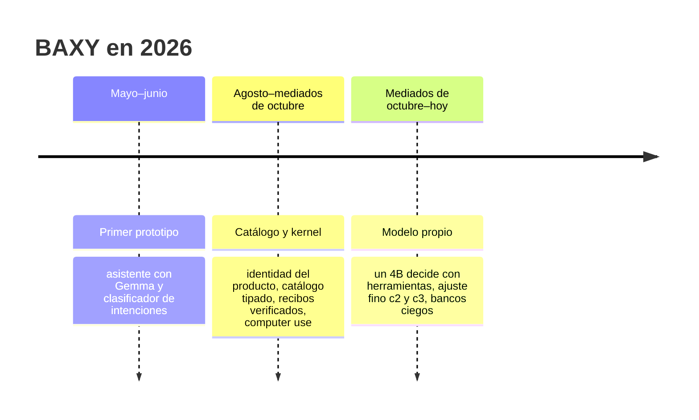

# Cómo se construyó BAXY

Esta carpeta guarda el recorrido completo del proyecto: qué se intentó, qué se midió, qué se descartó y por qué. Está
pensada para quien quiera entender las decisiones de BAXY o replicar partes de él (sobre todo el ajuste fino y la
forma de evaluar).

Los documentos son los de trabajo, escritos mientras se avanzaba, y se conservan tal cual salvo por la limpieza de
datos personales (rutas, nombres de máquinas y de personas, direcciones). Muchos usan nombres internos de cada etapa;
el glosario de abajo los traduce.

## Las tres etapas

### 1. Primer prototipo (mayo–junio de 2026)

Un asistente en Python que clasificaba la petición con un enrutador de intenciones y rellenaba plantillas, con
modelos pequeños locales (Gemma) y una interfaz de escritorio. Enseñó lo que no había que repetir: frases fijas, listas de
aplicaciones escritas en el código y éxitos que nadie comprobaba. Su repositorio es privado y no forma parte de esta
historia publicada.

### 2. Catálogo y kernel (agosto – mediados de octubre de 2026)

Se reescribió desde cero con una arquitectura que todavía sigue: **la mente propone, el kernel autoriza, el
proveedor ejecuta**, con un catálogo tipado como única fuente de operaciones y recibos verificados.

- **Identidad del producto** (16 de agosto): 52 preguntas respondidas una por una sobre qué es BAXY, cómo habla, qué
  confirma y qué nunca hace. Resultado: [identidad.md](../identidad.md) y las
  [preguntas](catalogo-y-kernel/00_IDENTIDAD_PREGUNTAS.md).
- **Once objetivos de producto** (comprensión, honestidad, ejecución verificada, voz, primera señal, uso diario…)
  y una campaña de cierre por capacidades medida caso a caso.
- **Computer use** (octubre): manejar cualquier aplicación con UI Automation, OCR y visión.
  [Contrato de vista y acción](catalogo-y-kernel/computer-use/CONTRATO_VISTA_ACCION.md),
  [mediciones](catalogo-y-kernel/computer-use/MEDICIONES.md),
  [decisión del modelo de visión](catalogo-y-kernel/computer-use/DECISION_VISION_V3.md) y
  [estabilización](catalogo-y-kernel/computer-use/ESTABILIDAD.md).

Lo que se aprendió: la arquitectura era sólida, pero entender peticiones con un clasificador y redactar con
plantillas tenía un techo. Con 4 GB de VRAM, un modelo pequeño que llama herramientas directamente prometía más.

Documentos clave:

| Documento | Qué cuenta |
|---|---|
| [ADR/](catalogo-y-kernel/ADR/README.md) | Decisiones de arquitectura: kernel, GPU, paquete reproducible, instalador, mente, voz |
| [03_COSTURAS.md](catalogo-y-kernel/03_COSTURAS.md) | Qué piezas se pueden cambiar y qué medición decide el cambio |
| [04_ARQUITECTURA_TECNOLOGICA.md](catalogo-y-kernel/04_ARQUITECTURA_TECNOLOGICA.md) | El torneo de tecnologías (runtime, modelos, voz) |
| [SEMANTICA.md](catalogo-y-kernel/SEMANTICA.md) | Cómo se entendía un mensaje y lo que se midió |
| [REGISTRO_DE_MANTENIBILIDAD.md](catalogo-y-kernel/01_ARQUITECTURA/REGISTRO_DE_MANTENIBILIDAD.md) | Todo lo medido, promovido y rechazado (muy largo) |
| [LIMITES_DE_BAXY.md](catalogo-y-kernel/LIMITES_DE_BAXY.md) | Lo que BAXY hace siempre y lo que no hace |
| [NAVEGADOR_USUARIO.md](catalogo-y-kernel/NAVEGADOR_USUARIO.md) | Cómo BAXY usa el navegador de la persona sin tocar su perfil |
| [GUIA_AGENTES_IA/](catalogo-y-kernel/01_ARQUITECTURA/GUIA_AGENTES_IA/README.md) | Guía técnica del repositorio de esa etapa, incluida la latencia de punta a punta |

### 3. Modelo propio (mediados de octubre de 2026 – hoy)

La versión actual: **el modelo decide con herramientas nativas** y la honestidad pasa a los recibos y a la
comprobación de la respuesta. Se conservaron el kernel, el catálogo, los proveedores y la App; se cambió la mente.

| Fecha | Paso | Documento |
|---|---|---|
| 15-10 | Investigación: herramientas para un 4B, falsedades, computer use, latido | [investigacion/](modelo-propio/investigacion/arnes.md), [falsedades](modelo-propio/investigacion/falsedades.md) |
| 15–17-10 | Primera versión con Qwen3.5-4B base y voz propia Supertonic | [traspaso del 15-10](modelo-propio/TRASPASO_2026-10-15.md), [informe](modelo-propio/INFORME_FINAL.md) |
| 17-10 | Auditoría de las peticiones reales (sólo cifras) | [auditoria_reales.md](modelo-propio/auditoria_reales.md) |
| 18–19-10 | **Ajuste fino c2**: receta e informe | [RECETA.md](modelo-propio/ft/RECETA.md), [INFORME_FT.md](modelo-propio/ft/INFORME_FT.md) |
| 19–20-10 | Ayudas al modelo sin reentrenar (pistas en los errores, descripciones) | [INFORME_AYUDAS.md](modelo-propio/ayudas/INFORME_AYUDAS.md) |
| 20–21-10 | Uso real y computer use caso a caso | [USO_REAL.md](modelo-propio/uso/USO_REAL.md), [CU_CASOS.md](modelo-propio/cu/CU_CASOS.md) |
| 22–25-10 | «Al máximo»: palancas de latencia y calidad, holdouts v5 y v6 | [MAXIMO.md](modelo-propio/maximo/MAXIMO.md), [INFORME_MAXIMO.md](modelo-propio/maximo/INFORME_MAXIMO.md), [MEDIR.md](modelo-propio/maximo/MEDIR.md) |
| 27-10 | Feria científica: demostraciones y arreglos | [feria/INFORME.md](modelo-propio/feria/INFORME.md), [DEMOS.md](modelo-propio/feria/DEMOS.md) |
| 29–31-10 | **Ajuste fino c3**, fallos de la App, banco ciego y lentitud | [BRIEF_FT_C3.md](modelo-propio/maximo/BRIEF_FT_C3.md), [INFORME_C3.md](modelo-propio/ft/INFORME_C3.md), [INFORME_FALLOS_APP_C3.md](modelo-propio/ft/INFORME_FALLOS_APP_C3.md), [BANCO_CIEGO_C3.md](modelo-propio/ft/BANCO_CIEGO_C3.md), [LENTITUD_C3.md](modelo-propio/ft/LENTITUD_C3.md) |

El diario completo de esta etapa, día a día, está en [PROGRESO.md](modelo-propio/PROGRESO.md) (muy largo) y en
[PROGRESO-portatil.md](modelo-propio/PROGRESO-portatil.md). El historial de metas, bancos sellados y decisiones está
en [metas.json](modelo-propio/metas.json).

Lo que se aprendió:

1. **Los recibos y la comprobación de la respuesta frenan más falsedades que cualquier instrucción en el prompt.**
2. **Un ajuste pequeño y limpio gana a uno grande.** En c3, sumar todas las familias de datos empeoró todos los
   bancos; ganó una receta de 5.727 muestras.
3. **Muchos fallos que parecen del modelo son de la App.** En c3, dos de cada tres fallos de las pruebas de punta a
   punta se arreglaron en la App, no en el modelo.
4. **Medir a ciegas y por pares.** Con tres semillas, juez ciego y McNemar, una mejora de 8 misiones se puede
   distinguir del ruido; sin eso, no.

## Cómo se trabajó

El proyecto lo desarrolló una sola persona con agentes de programación (Claude, Codex y Grok) como herramientas: los
agentes escribían código y ejecutaban bancos, y las decisiones de producto, los criterios de los jueces y la
elección de cada versión fueron del autor. Se trabajó en dos máquinas, un PC de escritorio (RTX 4060 Ti) y un
portátil (RTX 3060 de 6 GB), y los ajustes finos grandes se entrenaron en GPU alquiladas. Por eso muchos documentos
hablan de «el PC» y «el portátil», de «sesiones» y de «traspasos» entre ellas.

## Glosario

| Término | Significado |
|---|---|
| Definitivo, C01–C03 | Nombres internos de la etapa 2 y de sus campañas de cierre por capacidades |
| Renew | Nombre interno de la etapa 3 (modelo con herramientas) |
| c2, c2e1, c3, c3r9b | Versiones del ajuste fino; c3r9b semilla A es el modelo publicado |
| Holdout v3…v7 | Bancos sellados, medidos una sola vez por versión |
| decision2, escenas, e2e, falsedades | Bancos de decisión, del latido, de punta a punta y de falsedades (ver [evaluacion.md](../evaluacion.md)) |
| Latido | Un modo que miraba el escritorio sin que nadie hablara; quedó apagado y fuera de los bancos |
| Laya / System One | Un segundo modelo pequeño de decisión en la CPU; no mejoró nada medible y quedó apagado |
| Palanca | Un cambio candidato (de código, de prompt o de datos) medido por separado |
| Objetivo / traspaso | Encargo de trabajo de una etapa / nota para continuar en otra sesión |

## Rutas citadas en el código

Algunos comentarios del código citan documentos por su ruta antigua. Equivalencias:

| Ruta antigua | Ruta actual |
|---|---|
| `documentacion/00_IDENTIDAD.md` | [`docs/identidad.md`](../identidad.md) |
| `documentacion/<resto>` | `docs/construccion/catalogo-y-kernel/<resto>` (`GOAL_*` → `OBJETIVO_*`, `HANDOFF*` → `TRASPASO*`) |
| `artifacts/renew/<resto>` | `docs/construccion/modelo-propio/<resto>` (`*-nb.md` → `*-portatil.md`), salvo `metas.json` y `maximo/CRITERIO_FALSEDADES.md`, que siguen donde las leen los scripts |
| `artifacts/feria/<resto>` | `docs/construccion/modelo-propio/feria/<resto>` |
| `RENEW_TRASPASO.md` | [`docs/construccion/modelo-propio/TRASPASO_2026-10-15.md`](modelo-propio/TRASPASO_2026-10-15.md) |
| `PROMPT_GOAL_RENEW.md` y otros `PROMPT_*.md` | Encargos de trabajo; no se publican |
